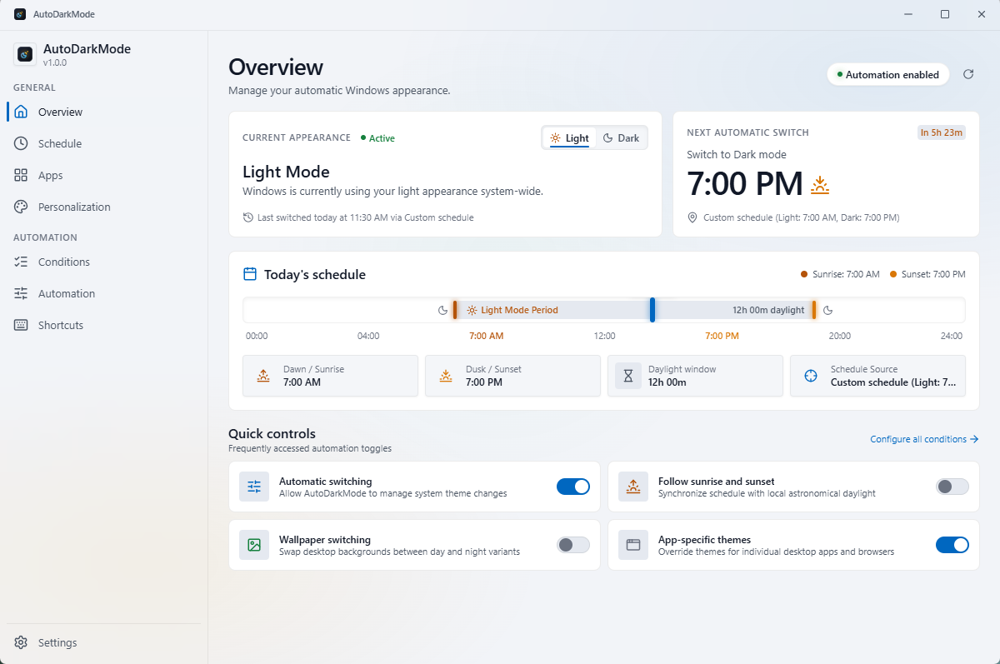
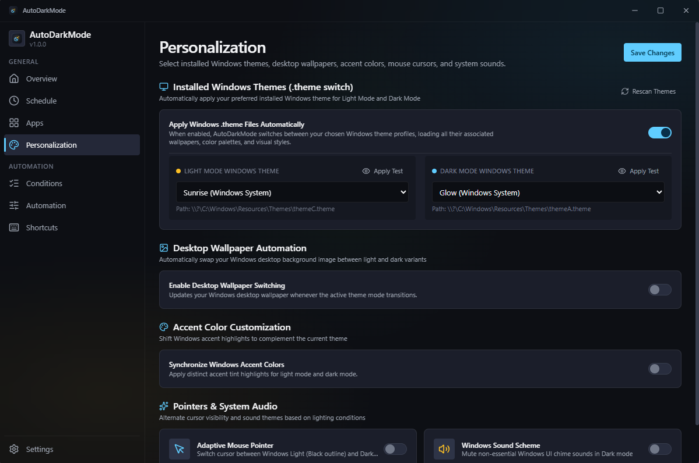

# AutoDarkMode — Windows 11 Desktop Application

[](https://opensource.org/licenses/MIT)
[](https://www.microsoft.com/windows)
[](https://tauri.app)
[](https://svelte.dev)
[](https://www.rust-lang.org)

**AutoDarkMode** is a fast, lightweight, open-source Windows 11 desktop application designed to automatically switch between Light and Dark themes based on astronomical sunrise and sunset, custom schedules, and real-time system conditions.

Built with **Rust**, **Tauri 2**, **Svelte 5**, **TypeScript**, and **Tailwind CSS**, AutoDarkMode combines native Windows 11 Fluent Design and DWM Mica materials with a minimal memory footprint and zero external telemetry.

---

## Key Features

### 🌓 Automated Theme Switching
- **Astronomical Solar Tracking:** Uses local geographic coordinates and NOAA solar positioning algorithms to accurately schedule switches based on civil sunrise and sunset, with configurable minute offsets.
- **Custom Time Windows:** Define exact manual start times for light and dark themes with midnight-crossing support.
- **Windows System Broadcast:** Sends immediate `WM_SETTINGCHANGE` broadcasts (`ImmersiveColorSet` and `WindowsThemeElement`) so Windows Shell, Taskbar, Start Menu, and running apps update smoothly without restarting.

### 🎨 Windows 11 Fluent Design & Mica
- **Native DWM Integration:** Leverages Desktop Window Manager APIs (`DWMWA_SYSTEMBACKDROP_TYPE` / `DWMSBT_MAINWINDOW`) to render genuine Windows 11 Mica material and immersive dark titlebars.
- **Fluent Nightfall Design System:** Beautiful, responsive UI built with Tailwind CSS, custom design tokens, and Segoe UI Variable typography.

### 🧩 Dual-Window Architecture & System Tray
- **OneDrive-Style System Tray Popup:** Click the system tray icon for a compact, quick flyout menu anchored above the taskbar to toggle themes, pause automation, or navigate into settings.
- **Silent Background Daemon:** Closing the main window preserves the background scheduler in the notification area. Process priority automatically shifts to `BELOW_NORMAL_PRIORITY_CLASS` to minimize CPU and battery usage.
- **Single-Instance Protection:** Prevents duplicate processes; launching the application while it is running automatically brings the existing window to the foreground.

### ⚙️ Deep Windows Personalization & Conditions
- **Wallpaper Switching:** Automatically changes desktop wallpaper between designated Light and Dark background images using Win32 `SystemParametersInfoW`.
- **Installed Windows Themes:** Discovers and applies installed `.theme` files from `%SystemRoot%\Resources\Themes` and `%AppData%\Microsoft\Windows\Themes`.
- **Smart Conditions & Gaming Inhibit:** Monitors full-screen games and presentations via `SHQueryUserNotificationState` and pauses switching during gameplay.
- **Battery & Power Awareness:** Reads battery state via `GetSystemPowerStatus` and can pause switching or force dark mode when on battery saver.
- **Per-App Theme Rules:** Configure rules for individual processes (e.g., VS Code, Windows Terminal).

### 🛡️ Privacy & Atomic Reliability
- **100% Offline:** Zero external network calls, zero tracking, zero telemetries.
- **Atomic Configuration:** Settings persist in `%APPDATA%\AutoDarkMode\config.json` with temporary file swapping and automatic corruption recovery.

---

## Screenshots

| Overview Dashboard (Light Theme) | Personalization & Themes (Dark Theme) |
| :---: | :---: |
|  |  |

---

## Supported Operating Systems

- **Primary:** Windows 11 (all editions, 64-bit). Full native Mica material backdrop support on Windows 11 22H2 (Build 22621) and newer.
- **Compatible:** Windows 10 (version 1809 and newer, 64-bit). Falls back cleanly to solid layered backgrounds when DWM Mica is unavailable.

---

## Technology Stack

| Layer | Technology | Details |
| :--- | :--- | :--- |
| **Backend Core** | Rust (Edition 2021) | Safe native Win32 integrations (`windows` crate), Tokio runtime, Chrono |
| **Application Runtime** | Tauri 2 (`2.1.1`) | Minimal memory overhead, native WebView2 windowing, least-privilege permissions |
| **Frontend Framework** | Svelte 5 (`^5.19.2`) | Reactive runes architecture (`$state`, `$derived`, `$props`) |
| **UI & Styling** | Tailwind CSS 3 & PostCSS | Fluent Nightfall token palette, dark/light theme switching |
| **Icons** | `@lucide/svelte` | Crisp, scalable iconography |
| **Build & Tooling** | Vite 6 & TypeScript 5 | Strict TypeScript typing with rapid HMR |

---

## Architecture & Project Structure

The codebase strictly decouples frontend presentation from native Rust backend services:

```text
AutoDarkMode/
├── docs/                        # Project documentation & screenshots
│   └── screenshots/             # Application UI screenshots
│
├── src/                         # Svelte 5 + TypeScript Frontend
│   ├── components/              # UI components
│   │   ├── apps/                # App-specific theme override view
│   │   ├── automation/          # Startup & daemon preferences view
│   │   ├── conditions/          # Battery & gaming conditions view
│   │   ├── dashboard/           # Overview cards (Appearance, Next Switch, Timeline, Quick Controls)
│   │   ├── layout/              # Shell layout (Header/Titlebar, Sidebar, StatusBar)
│   │   ├── personalization/     # Wallpaper & installed theme selector view
│   │   ├── schedule/            # Solar astronomical & custom times view
│   │   ├── settings/            # Import/Export, config reset & diagnostics view
│   │   ├── shortcuts/           # Keyboard shortcut bindings view
│   │   ├── tray/                # OneDrive-style compact system tray popup
│   │   └── ui/                  # Reusable Fluent components (Button, Toggle, SegmentedControl, Card)
│   ├── services/                # Typed Tauri IPC service with browser fallback
│   ├── stores/                  # Svelte 5 reactive stores ($state classes)
│   ├── styles/                  # Tailwind CSS & design tokens
│   ├── types/                   # TypeScript interfaces mirroring Rust models
│   ├── App.svelte               # Root component (handles main window & tray flyout views)
│   └── main.ts                  # Frontend entry point
│
├── src-tauri/                   # Tauri 2 & Rust Backend
│   ├── capabilities/            # Least-privilege IPC capabilities
│   ├── icons/                   # Application and system tray icons
│   ├── src/                     # Rust backend implementation
│   │   ├── commands/            # Tauri IPC command handlers
│   │   ├── config/              # Atomic JSON configuration manager & migration
│   │   ├── scheduler/           # Background scheduling daemon
│   │   ├── state/               # Astronomical solar math & timeline computations
│   │   ├── tray/                # Windows notification area / system tray integration
│   │   ├── windows/             # Win32 APIs (Registry, DWM Mica, Power, Gaming, Themes)
│   │   ├── lib.rs               # Application lifecycle & command registration
│   │   └── main.rs              # Windows entry point
│   ├── Cargo.toml               # Cargo dependencies & release optimization profile
│   ├── build.rs                 # Tauri build hook
│   └── tauri.conf.json          # Tauri application configuration & security
│
├── .github/                     # Workflows and templates
├── package.json                 # Node dependencies and scripts
└── tsconfig.json                # Strict TypeScript configuration
```

---

## Installation & Getting Started

### Prerequisites

- [Node.js](https://nodejs.org/) (v18 or v20+ recommended)
- [Rust](https://www.rust-lang.org/tools/install) (stable MSVC toolchain)
- [Visual Studio C++ Build Tools](https://visualstudio.microsoft.com/visual-cpp-build-tools/)
- Windows 10 / 11 with WebView2 Runtime

### Setup

1. **Clone the repository:**
   ```powershell
   git clone https://github.com/nitinduseja/auto-dark-mode.git
   cd auto-dark-mode
   ```

2. **Install frontend dependencies:**
   ```powershell
   npm install
   ```

3. **Run in development mode:**
   ```powershell
   # Runs the desktop app with live reload and Tauri IPC
   npm run tauri:dev
   ```

   *Tip: To iterate quickly on UI components inside your browser without native desktop APIs, run `npm run dev`.*

---

## Building for Production

AutoDarkMode uses Cargo's release profile with maximum binary size and runtime optimization (`opt-level = "z"`, fat LTO, single codegen unit, and symbol stripping).

### 1. Build via Tauri CLI (Recommended)

This compiles the Svelte frontend and the optimized native Windows binary in one step:

```powershell
npm run tauri:build
```

### 2. Build via Direct Cargo Command

Alternatively, compile using standard Cargo:

```powershell
# 1. Build frontend distribution
npm run build

# 2. Compile native Rust backend in release mode
cargo build --release --manifest-path src-tauri/Cargo.toml --features custom-protocol
```

The resulting optimized executable will be located at:
```text
src-tauri/target/release/autodarkmode.exe
```

---

## Automated Releases (CI/CD)

Production builds and GitHub releases are fully automated via GitHub Actions:
- **Trigger:** Pushing a version tag (e.g., `git push origin v1.0.0`).
- **Pipeline:** Runs on `windows-latest`, installs dependencies with `npm ci`, builds frontend production bundles, compiles the Rust release executable using Cargo's release profile, computes SHA-256 checksums, and attaches `AutoDarkMode.exe` and `AutoDarkMode.exe.sha256` directly to a GitHub Release.


---

## Automated Testing

Run the full automated test suite to ensure code health:

```powershell
# Svelte 5 and TypeScript type diagnostics
npm run check

# Rust backend unit tests (solar calculations, config recovery, registry safety)
cargo test --manifest-path src-tauri/Cargo.toml --features custom-protocol
```

---

## Native Win32 Technical Details

### Registry Integration
- **Subkey:** `HKEY_CURRENT_USER\Software\Microsoft\Windows\CurrentVersion\Themes\Personalize`
- **Values:** `AppsUseLightTheme` (`0` = Dark, `1` = Light) and `SystemUsesLightTheme` (`0` = Dark, `1` = Light).
- Every write operation is followed by immediate read-back verification to detect permission issues or registry locks.

### Shell Notification Broadcast
When a theme switch occurs, AutoDarkMode broadcasts:
```rust
SendMessageTimeoutW(HWND_BROADCAST, WM_SETTINGCHANGE, WPARAM(0), LPARAM(param.as_ptr() as isize), SMTO_ABORTIFHUNG, 1000, Some(&mut result));
```
for both `"ImmersiveColorSet"` and `"WindowsThemeElement"`. This informs running WinUI, UWP, and Win32 applications to immediately reload their theme brushes.

### DWM Mica Backdrop
- Window attribute `DWMWA_USE_IMMERSIVE_DARK_MODE` (attribute `20`) synchronizes the non-client area dark mode status.
- Window attribute `DWMWA_SYSTEMBACKDROP_TYPE` (attribute `38`, value `DWMSBT_MAINWINDOW = 2`) activates native Mica material on Windows 11.

---

## Contributing

Contributions, bug reports, and suggestions are welcome! Please read our [Contributing Guide](CONTRIBUTING.md) and [Code of Conduct](CODE_OF_CONDUCT.md) for details on submitting pull requests and reporting issues.

---

## License

This project is licensed under the [MIT License](LICENSE).
